<div align="center">

# Nightdrop

**A music visualizer and screensaver for Android TV.**

Every frame is the last one, warped a little by the music, faded, and drawn over: the feedback loop
MilkDrop made famous, written from scratch for a TV. Eleven presets, colours pulled from the album
art, a new scene with every song, and a screensaver that knows whether the room is listening.


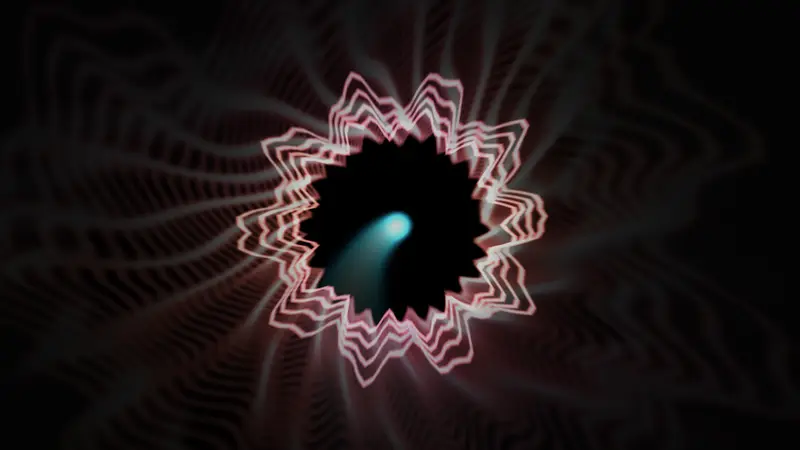

<sub>Rendered offline with <code>tools/preview.py</code>: a made-up cover, synthetic music at 124 BPM.</sub>

</div>

---

## On the TV

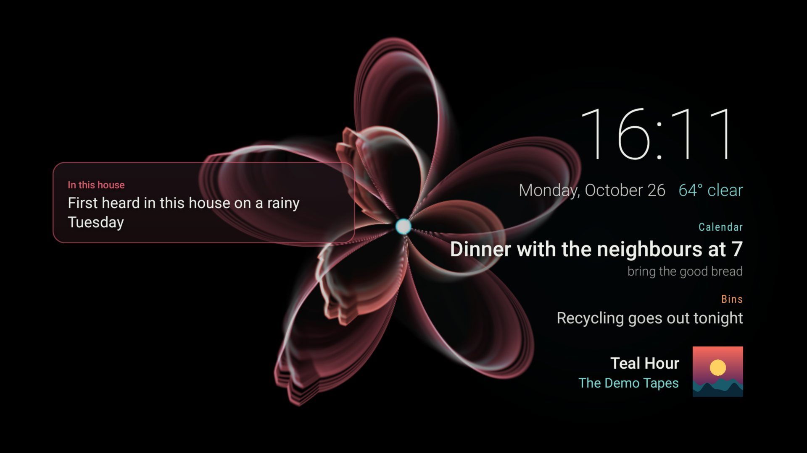

| | |
|:---:|:---:|
| 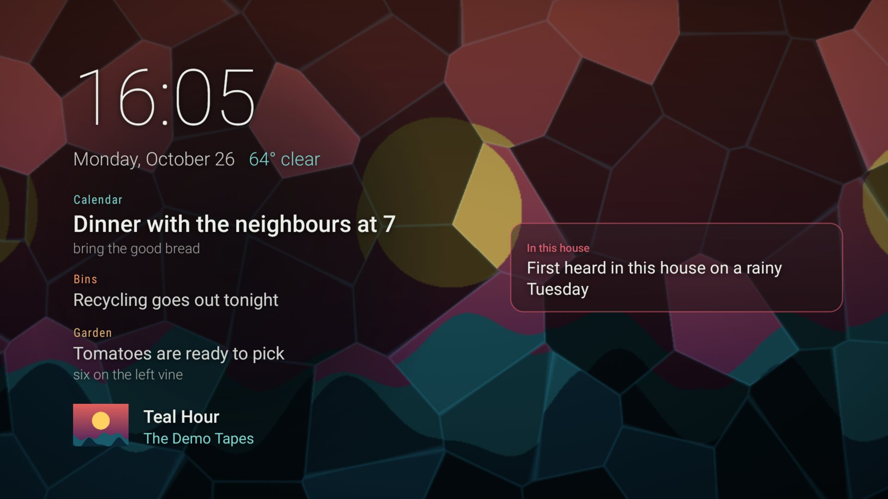<br><sub>The screensaver while music plays: Shards cut from the cover, the plate, a pop fact</sub> | 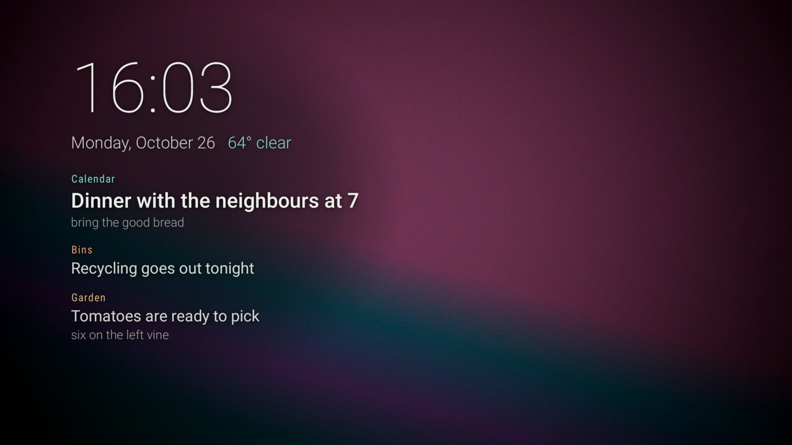<br><sub>The music stops: after 20 s a reel takes over behind the plate</sub> |
| 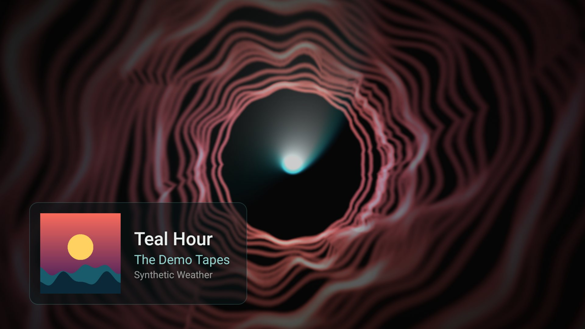<br><sub>The app: a track card on each new song</sub> | 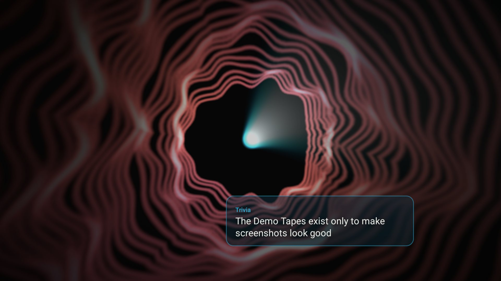<br><sub>A pop fact, tinted from the cover</sub> |

<sub>Captured on an NVIDIA SHIELD TV Pro: a made-up track (The Demo Tapes, sine waves and a generated cover)
and <code>examples/feed_server.py</code> serving <code>examples/items.json</code> and <code>examples/facts.json</code>.</sub>

## Contents

[On the TV](#on-the-tv) · [Features](#features) · [The presets](#the-presets) · [How it works](#how-it-works) ·
[Install](#install) · [Configure](#configure) · [The feed](#the-feed) · [Reels](#reels) · [Build](#build) ·
[Writing a preset](#writing-a-preset) · [Troubleshooting](#troubleshooting) · [License](#license)

## Features

| | |
|---|---|
| **Hears anything** | Taps the device's mixed audio output, so Spotify, YouTube Music, Plex or a radio app all drive it with no support from the playing app |
| **Eleven presets** | Tunnels, a synthwave horizon, nebulae, kaleidoscopes, aurora, neon rain, ridgelines, a starfield warp, roses, ripples, stained glass |
| **Colours from the cover** | Three colours pulled from the album art, weighted by saturation and lifted to glow on black; three presets draw the cover itself |
| **Scene per song** | A new preset with every track; a long DJ mix moves on by itself. Left/Right or the remote's skip keys step by hand |
| **A screensaver with two moods** | Visuals while music plays; your own looping videos when it stops. Over either, a plate with the time, date, weather and a few headlines, drifting corner to corner so an OLED never holds it |
| **Pop facts** | Glass cards with facts about the song float over the visuals, the label and rim tinted from the cover |
| **Your data, your server** | One optional HTTP feed for the plate and the facts. The included example serves your own items, Open-Meteo weather and Wikipedia facts with no keys |
| **Small** | Kotlin, the Android SDK and OpenGL ES 3. No libraries, no analytics, no network unless you name a feed |

## The presets

| | | |
|:---:|:---:|:---:|
| 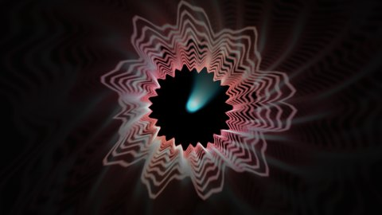<br>**Tunnel**<br><sub>the frame falls inward and turns; the waveform is a ring</sub> | 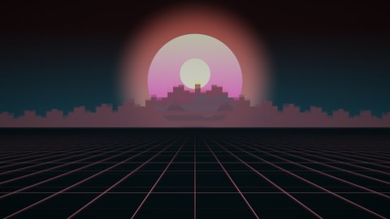<br>**Horizon**<br><sub>a synthwave grid at the tempo, the cover as the sun, the spectrum as skyline</sub> | 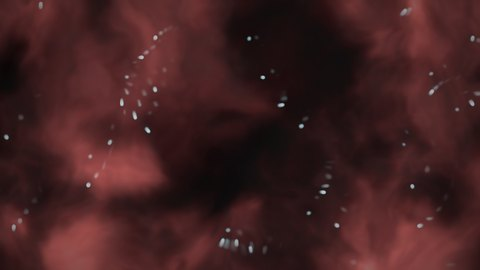<br>**Flow**<br><sub>a nebula the frame drifts through, sparks on the beat</sub> |
| 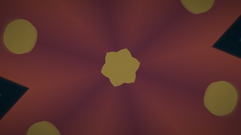<br>**Mirror**<br><sub>the cover in a six-way kaleidoscope that breathes with the bass</sub> | 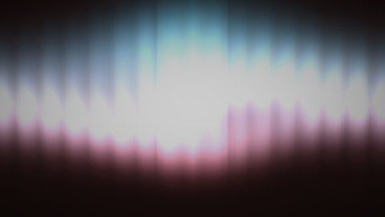<br>**Aurora**<br><sub>curtains whose brightness is the spectrum</sub> | 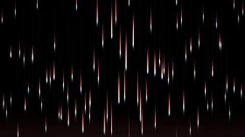<br>**Rain**<br><sub>neon rain down dark glass, each lane its own band</sub> |
| 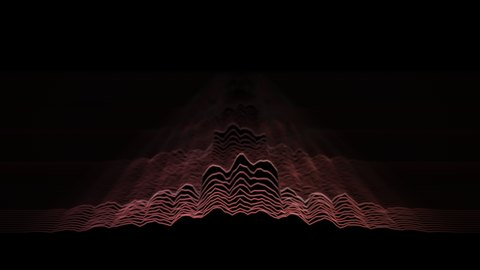<br>**Ridge**<br><sub>each frame's spectrum a new ridge; the old ones recede</sub> | 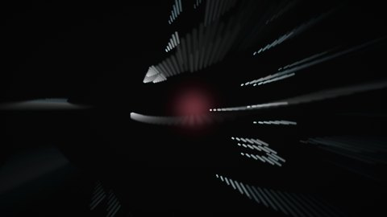<br>**Warp**<br><sub>stars born in the middle, flung out by the zoom</sub> | <br>**Petals**<br><sub>two polar roses turning against each other</sub> |
| 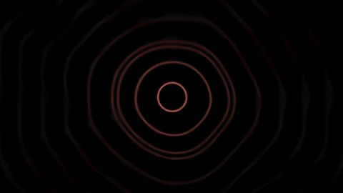<br>**Ripple**<br><sub>a still pond; every beat drops a ring</sub> | 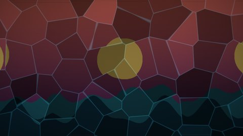<br>**Shards**<br><sub>the cover broken into slow glass cells, each lit by its own band</sub> | |

## How it works

<picture>
  <source media="(prefers-color-scheme: dark)" srcset="docs/img/diagrams/how-it-works-dark.svg">
  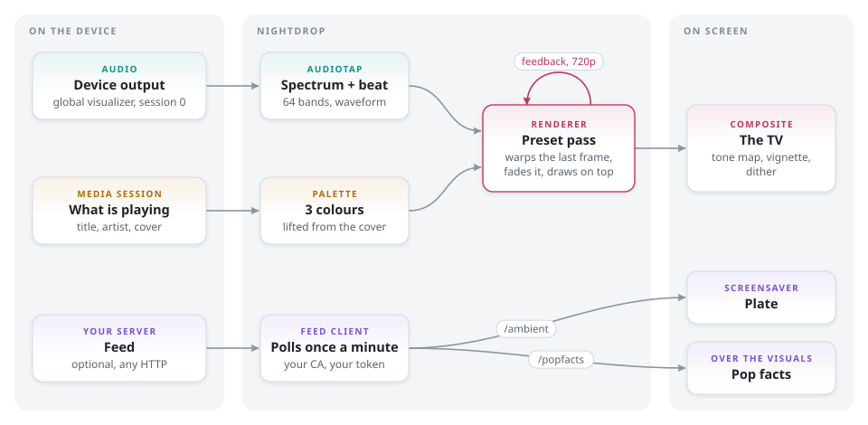
</picture>

Each preset is one fragment shader. It reads the previous frame, moves it a little (zoom, turn,
drift, all driven by the audio), lets it fade, and draws something new on top; the trails and
tunnels are that loop, not anything drawn on purpose. The loop runs at 720p (the trails are soft
anyway) and one composite pass scales it to the screen with a dither so the dark gradients never band.

When nothing has made a sound for three seconds, the inputs fall back to slow sines, so the screen
breathes instead of freezing on the last trail.

**The screensaver** picks its backdrop by what the room is doing:

<picture>
  <source media="(prefers-color-scheme: dark)" srcset="docs/img/diagrams/screensaver-dark.svg">
  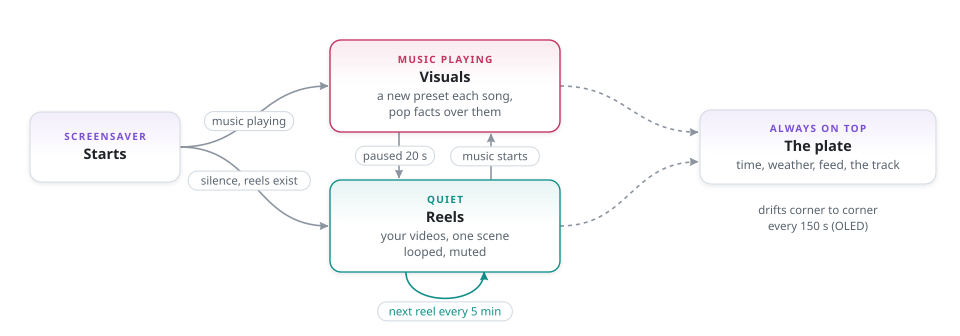
</picture>

## Install

Grab the APK from [Releases](https://github.com/chungus-actual/nightdrop/releases) and sideload it.
On the TV: Settings > Device Preferences > About > Build, press seven times; then Developer options >
USB debugging or network debugging.

```sh
adb connect <tv-ip>:5555
adb install nightdrop-0.1.1.apk
```

| Step | How |
|---|---|
| 1. Permissions | Open Nightdrop once and allow both prompts. The microphone permission is what Android asks for the audio visualizer (nothing is recorded); the video one lets the screensaver play your reels |
| 2. Track names and covers | `adb shell cmd notification allow_listener io.github.chungus_actual.nightdrop/.MediaListener` |
| 3. Make it the screensaver | Settings > Device Preferences > Screen saver > Nightdrop. Google TV hides third-party screensavers there, so use `adb shell settings put secure screensaver_components io.github.chungus_actual.nightdrop/.Dream` |
| 4. Try it now | `adb shell am start -n com.android.systemui/.Somnambulator` |

Step 2 is there because Android lists the playing media sessions only to apps with notification
access. Nightdrop reads no notifications.

**Remote, in the app**

| Key | Does |
|---|---|
| Left / Right, media previous / next | previous / next preset |
| Up, Down, Center, Info | show the track card again |
| Back | leave |

## Configure

Everything is optional: with no config there is no feed and no pop facts, and the rest works. Put a
`nightdrop.json` ([example](examples/nightdrop.json)) in the app's folder; open the app once first,
which creates it.

```sh
adb push nightdrop.json /sdcard/Android/data/io.github.chungus_actual.nightdrop/files/
adb push ca.pem         /sdcard/Android/data/io.github.chungus_actual.nightdrop/files/   # only for your own CA
```

```json
{
  "feed": "https://192.0.2.10:8891",
  "ca": "ca.pem",
  "popFacts": true,
  "reels": "Movies/Reels",
  "sceneMinutes": 5
}
```

| Key | Default | Meaning |
|---|---|---|
| `feed` | `""` | base URL of your feed server; `""` = none |
| `ca` | `""` | a CA to trust for the feed instead of the system store: a file beside the config, or inline PEM. If it is named but missing, the feed is off |
| `token` | `""` | sent as `Authorization: Bearer <token>` |
| `popFacts` | `true` | ask the feed for pop facts |
| `reels` | `"Movies/Reels"` | the screensaver's video folder, under shared storage |
| `sceneMinutes` | `5` | how long one reel loops before another is picked |
| `plateItems` | `3` | feed items on the plate (0 to 6) |
| `driftSeconds` | `150` | how often the plate moves to another corner |
| `cycleMinutes` | `6` | a track longer than this (a DJ mix) changes preset by itself |

Changes apply the next time the app or the screensaver starts.

## The feed

Two GET endpoints on a server you run: `/ambient` for the plate, `/popfacts` for the cards. Full
shapes in **[docs/feed.md](docs/feed.md)**.

```json
{
  "items": [
    {"kicker": "Calendar", "headline": "Dinner with the neighbours at 7", "tone": "live", "tier": 1},
    {"kicker": "Bins", "headline": "Recycling goes out tonight", "tone": "needs"}
  ],
  "weather": {"temp": 72, "sky": "Sunny"}
}
```

No server yet? The example needs only Python:

```sh
python3 examples/feed_server.py --items examples/items.json --facts examples/facts.json \
    --lat 40.71 --lon -74.01 --wikipedia
```

| Flag | Gives you |
|---|---|
| `--items file.json` | your own headlines; edit the file and the next poll picks them up |
| `--lat`, `--lon`, `--units f\|c` | current weather from [Open-Meteo](https://open-meteo.com) (no key) |
| `--facts file.json` | your own pop facts, keyed `"artist\|title"`, `"artist\|*"` or `"*"` ([example](examples/facts.json)) |
| `--wikipedia` | pop facts: up to three sentences about the artist from Wikipedia |
| `--token`, `--cert`, `--key` | a bearer token and https |

A richer server can say much more: when a song was first played in the house, the calendar, the
chores, the pool temperature. Anything that answers the same JSON works.

## Reels

Any `.mp4`, `.mkv`, `.webm` or `.mov` in the reels folder joins the rotation. One loops, muted, for
`sceneMinutes`, then another at random.

```sh
adb shell mkdir -p /sdcard/Movies/Reels
adb push city-night.mp4 /sdcard/Movies/Reels/
```

A reel loops for minutes, so it should loop without a seam. `tools/make_reel.py` makes one from any
video: it crossfades the end into the start, crops to fill 16:9 and encodes HEVC 4:2:0 at 4K.

```sh
python3 tools/make_reel.py rain-window.mp4 rain-window-reel.mp4                  # NVIDIA GPU (hevc_nvenc)
python3 tools/make_reel.py rain-window.mp4 out.mp4 --encoder libx265 --size 1920x1080
python3 tools/make_reel.py loop.mp4 out.mp4 --seamless --pixel                   # pixel art that already loops
```

On a SHIELD, stay with 4:2:0: the Tegra X1 cannot decode 4:4:4 HEVC at 4K, and an encoder fed RGB
frames picks 4:4:4 unless told otherwise.

## Build

JDK 17 and the Android SDK (platform 34). The Gradle wrapper fetches the rest.

```sh
./gradlew assembleRelease      # app/build/outputs/apk/release/app-release.apk, debug-signed
```

| Switch | Effect |
|---|---|
| `-PappId=<id>` | another package id, to install beside a release build |
| `-Pbake=<dir>` | build a folder's `nightdrop.json` (and the CA file it names) in as the default config; one pushed to the device still wins |
| `KEYSTORE_FILE`, `KEYSTORE_PASSWORD`, `KEY_ALIAS`, `KEY_PASSWORD` | sign the release with your key |

## Writing a preset

Presets live in [`Shaders.kt`](app/src/main/java/io/github/chungus_actual/nightdrop/Shaders.kt).
Each is `COMMON` plus a `main()` that writes `o`:

| Input | What it is |
|---|---|
| `prevAt(p)` | the previous frame at a centred, aspect-correct point (`p.x` about -0.9 to 0.9, `p.y` -0.5 to 0.5) |
| `art(uv)` | the album art (a gradient of the cover colours when there is none) |
| `wave(x)`, `spec(x)` | waveform (-1 to 1) and log-spaced spectrum (0 to 2) for `x` in 0 to 1 |
| `uBass`, `uMid`, `uTreb`, `uBeat` | smoothed band levels, and a beat pulse that decays from 1 |
| `uC1`, `uC2`, `uC3` | the three cover colours |
| `rot`, `hash`, `noise`, `fbm` | the usual helpers |

Add it to `NAMES` and `PRESETS`, then render it on your desktop before you sideload anything:

```sh
pip install -r tools/requirements.txt
python tools/preview.py --demo-art MyPreset       # preview/mypreset.png + sheet.png
python tools/preview.py --art cover.jpg --anim tour.webp
```

Two lessons from a Tegra X1. `mediump` is a 16-bit float there (max 65504), so keep `highp` for
anything that multiplies screen coordinates: an overflow is a NaN, and a NaN is a black wedge across
the screen. And dynamically indexed uniform arrays past 32 entries read as zero, which is why the
audio arrives as a 64x2 texture.

## Troubleshooting

| Symptom | Cause, fix |
|---|---|
| "No track info" on screen | notification access missing: step 2 of Install |
| "Audio tap: ..." on screen, visuals only breathe | this device refuses the global audio visualizer (audio session 0); nothing to be done in the app |
| The screensaver shows only visuals, never reels | no videos in the reels folder, or the video permission was declined: open the app once and allow it |
| A reel is skipped | the device cannot decode it; re-encode it with `tools/make_reel.py` (`--size 1920x1080` for a 1080p box) |
| No plate headlines | check `feed` with `curl <feed>/ambient` from another machine; with `ca`, the file must sit beside `nightdrop.json` |
| Settings has no Nightdrop screensaver | Google TV: use the adb line in step 3 |

`adb logcat -s Nightdrop` shows what it is doing: the config it loaded, feed errors, the reels it plays.

## Companion launcher

[**chungus-actual/couchy-launcher**](https://github.com/chungus-actual/couchy-launcher) is a fork of
Couchy Launcher that uses the same reels folder as its wallpaper, shows the same feed in its status
bar, and has a now-playing chip whose last button starts the screensaver: the visuals, straight away.

## License

MIT, see [LICENSE](LICENSE). Nightdrop is an homage to Ryan Geiss's MilkDrop and shares no code
with it or with projectM.
